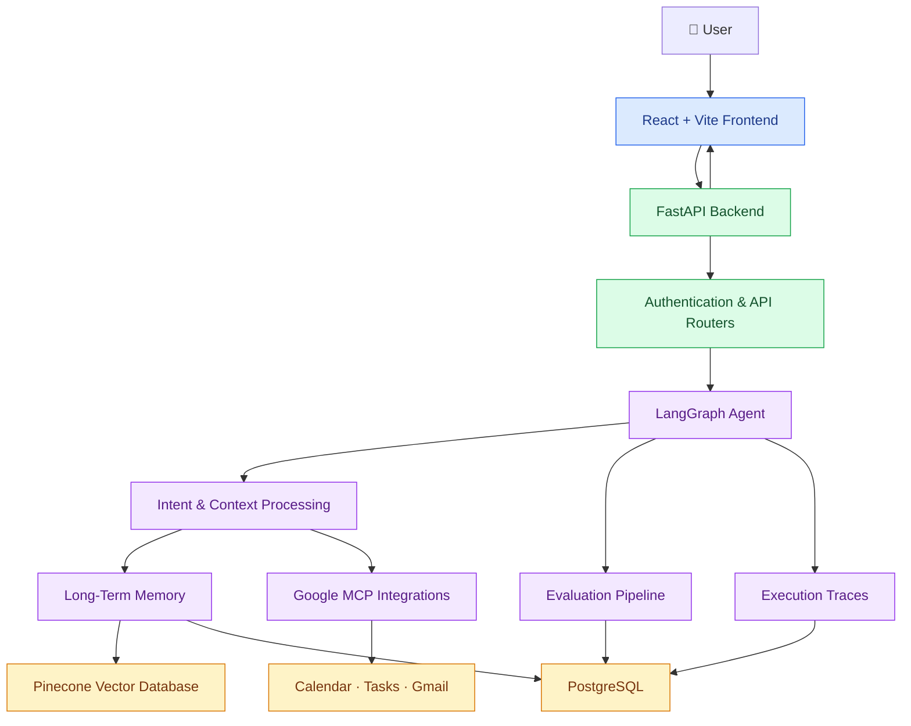
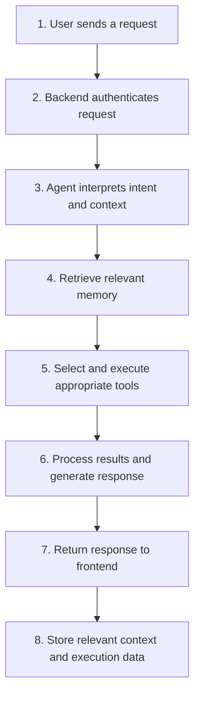

# MIRA — MCP Intelligent Routine Assistant

> **A personal AI assistant that doesn't just respond — it remembers, plans, and helps you act.**

MIRA is a full-stack AI productivity assistant built to help manage everyday routines through natural language. It integrates with Google services, maintains long-term conversational memory, executes tasks through an agent workflow, and provides observability and evaluation tools to measure its performance.

Instead of treating every conversation as an isolated interaction, MIRA is designed to connect your current requests with relevant context from previous interactions.

---

## ✨ What Makes MIRA Different?

| Capability | What MIRA does |
|---|---|
| 💬 Conversational AI | Understands requests and responds through an agent-driven chat interface |
| 🗓️ Calendar Integration | Accesses and manages schedule-related information |
| ✅ Task Management | Connects with Google Tasks to organize daily work |
| 🧠 Long-Term Memory | Retrieves relevant context using embeddings and Pinecone |
| 📝 Notes & Habits | Supports personal notes and recurring habit tracking |
| 🔍 Agent Observability | Exposes execution traces to help inspect agent behavior |
| 📊 Evaluation Framework | Measures tool usage, retrieval quality, groundedness, and latency |

## 🏗️ System Architecture

MIRA combines a React frontend, FastAPI backend, LangGraph agent orchestration, external integrations, persistent storage, and an evaluation pipeline.



### 🔄 How the Agent Works



The exact execution path depends on the request. A simple question may not require external tools, while a calendar-related request may involve Google integrations and stored context.

---

## 🧠 Core Engineering Concepts

### Agent orchestration
LangGraph coordinates the agent workflow, enabling requests to pass through the appropriate processing steps and tool integrations.

### Retrieval-augmented memory
MIRA uses embeddings and Pinecone to retrieve relevant information from stored context. PostgreSQL provides relational persistence for application data.

### Model and tool integration
Mistral AI supports language-model capabilities, while Google integrations provide access to productivity services.

### Observability and evaluation
Execution traces make agent behavior easier to inspect. The evaluation framework provides a way to measure quality and latency rather than relying only on subjective responses.

---

## 🧰 Technology Stack

| Layer | Technologies |
|---|---|
| Frontend | React 18, TypeScript, Vite, Tailwind CSS, React Router |
| Backend | Python 3.11+, FastAPI |
| Agent Framework | LangGraph |
| Language Model | Mistral AI |
| Integrations | Google OAuth, Calendar, Tasks, Gmail, MCP clients |
| Relational Database | PostgreSQL, SQLAlchemy, asyncpg |
| Vector Search | Pinecone, sentence-transformers |
| Database Migrations | Alembic |
| Testing | pytest |
| Deployment Support | Docker, Docker Compose |

---

## 📁 Project Structure

```text
MIRA/
├── backend/
│   ├── agents/          # Agent orchestration and tool nodes
│   ├── api/             # API routes and authentication
│   ├── database/        # Models and database connections
│   └── ...              # Memory, integrations, evaluation
├── frontend/
│   └── src/
│       └── pages/       # Chat, calendar, notes, evaluation, etc.
├── docs/
│   ├── architecture.md
│   ├── agent-graph.md
│   ├── api-reference.md
│   └── ...              # Additional technical documentation
├── tests/
├── alembic/             # Database migrations
├── run.py
├── docker-compose.yml
├── pyproject.toml
└── README.md
```

*This is a representative structure; exact filenames may vary with the current implementation.*

---

## 🚀 Getting Started

### Prerequisites

Install or arrange the following before running MIRA:

- Python 3.11 or newer
- Node.js 18 or newer and npm
- Git
- A PostgreSQL database
- A Pinecone account and API key
- Google Cloud OAuth credentials
- A Mistral AI API key

### 1. Clone the repository

```bash
git clone <YOUR_REPOSITORY_URL>
cd MIRA-AI
```

Replace the repository URL with your GitHub repository URL.

### 2. Configure environment variables

Create your environment file from the example:

```bash
# Windows PowerShell
Copy-Item .env.example .env

# macOS / Linux
cp .env.example .env
```

Add the credentials and configuration required by your local setup.

| Variable | Purpose |
|---|---|
| `MISTRAL_API_KEY` | Access to Mistral AI |
| `DATABASE_URL` | PostgreSQL connection |
| `PINECONE_API_KEY` | Vector database access |
| `GOOGLE_CLIENT_ID` | Google OAuth client |
| `GOOGLE_CLIENT_SECRET` | Google OAuth secret |
| `SECRET_KEY` | Application signing/security key |

Other settings may include `MISTRAL_MODEL`, `PINECONE_INDEX_NAME`, `GOOGLE_REDIRECT_URI`, `FRONTEND_URL`, `VITE_API_BASE_URL`, and `ENVIRONMENT`.

**Security:** Never commit your `.env` file or expose API keys, OAuth secrets, database credentials, or production data.

For Google OAuth configuration, see [`GOOGLE_OAUTH_SETUP.md`](GOOGLE_OAUTH_SETUP.md).

### 3. Start the backend

Create and activate a virtual environment:

```powershell
# Windows PowerShell
python -m venv .venv
.\.venv\Scripts\Activate.ps1
```

On macOS or Linux:

```bash
python3 -m venv .venv
source .venv/bin/activate
```

Install dependencies using the dependency file maintained by the project:

```bash
pip install -r requirements.txt
```

Then start FastAPI:

```bash
uvicorn backend.main:app --reload --port 8000
```

Alternatively, if supported by your checkout:

```bash
python run.py
```

Backend API: `http://localhost:8000`

Interactive API documentation: `http://localhost:8000/docs`

### 4. Start the frontend

Open a second terminal:

```bash
cd frontend
npm install
npm run dev
```

Open the development URL printed by Vite, typically:

`http://localhost:5173`

### 5. Run with Docker

If your Docker Compose configuration includes the required services and environment variables:

```bash
docker compose up --build
```

---

## 🧪 Testing & Quality Checks

Run the automated tests:

```bash
python -m pytest tests -q
```

Check Python files for compilation errors:

```bash
python -m compileall backend
```

Check frontend TypeScript types:

```bash
cd frontend
npx tsc --noEmit
```

MIRA's evaluation framework is intended to help assess agent behavior through measures such as:

- Tool-use correctness
- Retrieval quality
- Response groundedness
- Execution latency

These metrics help identify regressions as the agent evolves. Their actual coverage depends on the evaluation datasets and checks implemented in the repository.

---

## 📚 Documentation

Explore the technical documentation for more details:

- [Architecture](docs/architecture.md)
- [Agent Graph](docs/agent-graph.md)
- [API Reference](docs/api-reference.md)
- [Database](docs/database.md)
- [RAG Memory](docs/rag-memory.md)
- [Evaluation](docs/evaluation.md)
- [Frontend](docs/frontend.md)
- [Setup & Security](docs/setup-and-security.md)

---

## 🛣️ Design Philosophy

MIRA brings together conversational AI, external tools, persistent context, and measurable evaluation in one productivity-oriented application.

The core engineering objective is to make an assistant that is not only useful in a single interaction, but also easier to inspect, evaluate, and improve over time.

## 📄 License

No license is currently included. Add a license if you intend to distribute the project, and ensure that all included dependencies and assets can be shared under the chosen terms.

